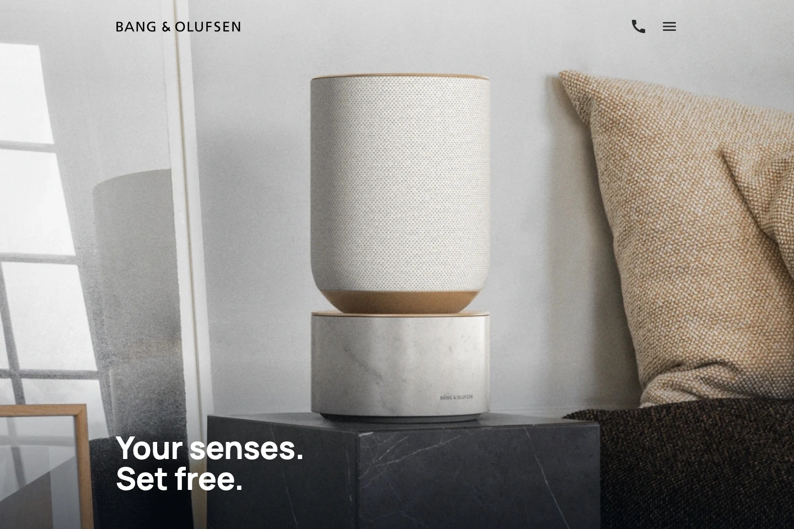
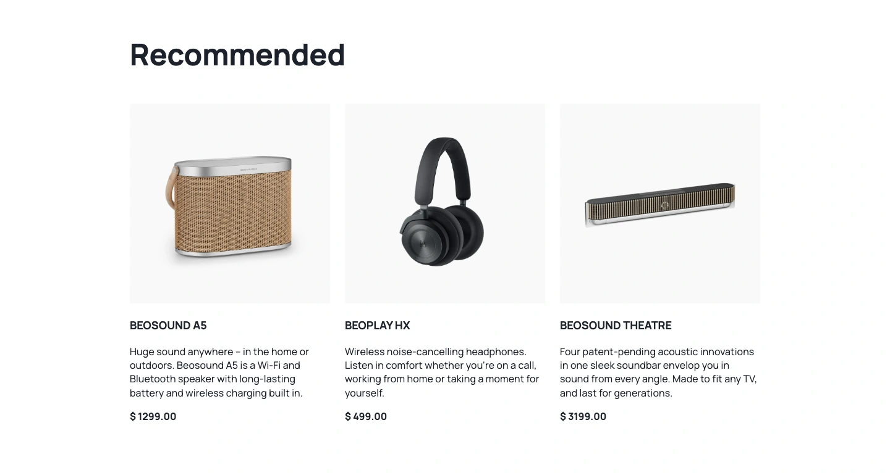
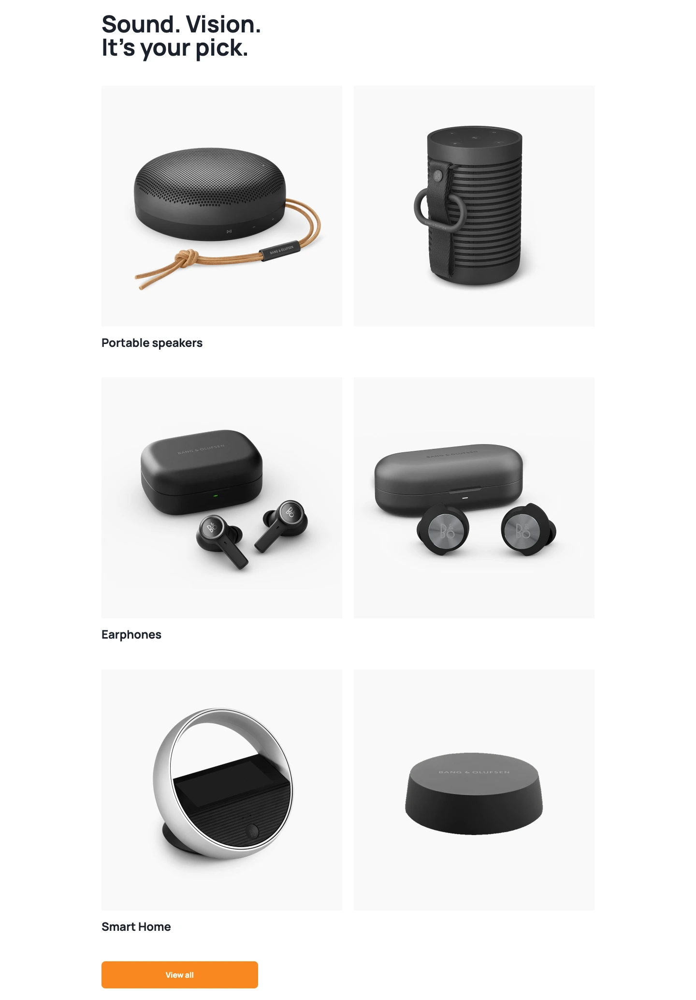
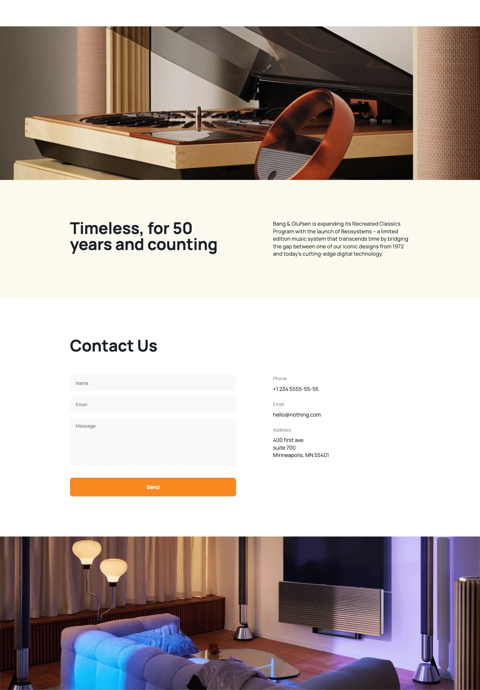
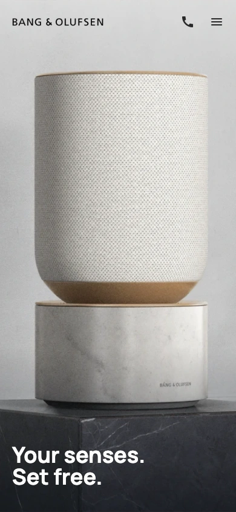
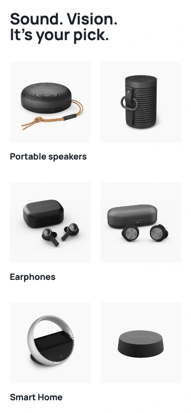
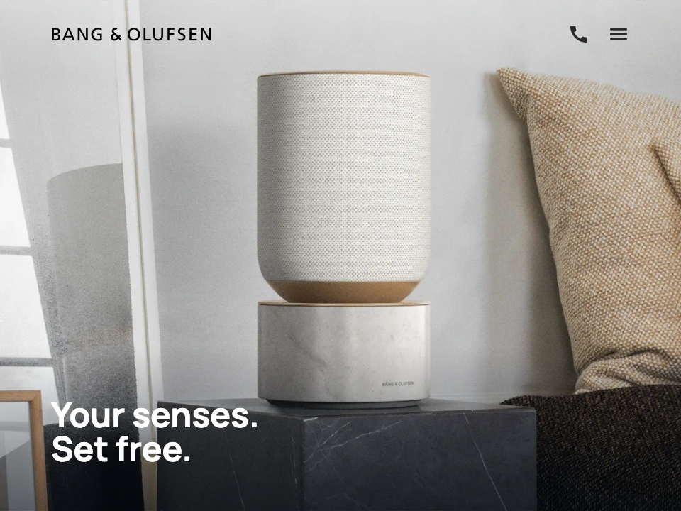
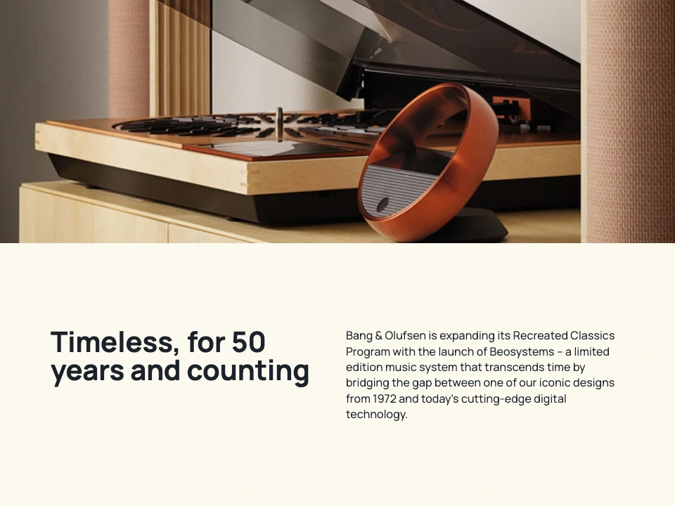

<div align="center">

# Bang & Olufsen

**Your senses. Set free.**

A responsive product landing page inspired by Bang & Olufsen's world of sound and design.
Built with HTML, SCSS, and vanilla JavaScript, with scroll animations powered by AOS.

**[Live Demo](https://ivam2280.github.io/bang-olufsen-landing-page/)**

**HTML5 · SCSS · JavaScript · AOS · Parcel**

[Overview](#overview) · [Screenshots](#screenshots) · [Getting started](#getting-started) · [GitHub Pages](#github-pages) · [Project structure](#project-structure)

</div>

[](docs/screenshots/desktop-hero.webp)

<p align="center"><sub>Desktop preview · 1440 × 960</sub></p>

## Overview

Bang & Olufsen is a single-page front-end project that combines warm lifestyle photography, spacious layouts, and a restrained interface with orange accents. The design adapts from compact mobile screens to a full desktop experience, keeping the focus on the products and their materials.

The page showcases Beosound A5, Beoplay HX, and Beosound Theatre, introduces three product categories, and presents the brand's Recreated Classics story before a dedicated contact section.

### Features

- **Responsive layout** — mobile-first styles with dedicated tablet and desktop breakpoints.
- **Product showcase** — three recommended audio products with imagery, descriptions, and prices.
- **Category gallery** — paired photographs for Portable speakers, Earphones, and Smart Home.
- **Responsive images** — product and category photography uses `<picture>` elements to serve different assets by screen size.
- **Full-screen navigation** — a CSS-driven menu with animated transitions, section links, and scroll locking.
- **Scroll animations** — AOS fade-up and fade-right effects reveal products, categories, and brand content once per page load.
- **Brand storytelling** — a full-width photograph and a warm background introduce the Recreated Classics Program.
- **Interactive details** — image hover effects, button states, smooth anchor scrolling, and orange focus outlines on form fields.
- **Contact section** — name, email, and message fields alongside telephone, email, and map links.
- **Finishing touches** — Manrope typography and a sticky photographic footer revealed as the visitor reaches the end of the page.

The contact form is a front-end demonstration. It resets on submission; message delivery is outside the current implementation.

## Screenshots

Eight screenshots across three device layouts: **4 Desktop · 2 Mobile · 2 Tablet**. Click any image to view it at full size. The desktop hero appears above; the remaining seven captures are below.

Section captures show complete content. Both tablet screenshots use the project's tablet layout at **960 × 720 px**.

### Desktop

Captured at a viewport width of **1440 px**.

**Recommended products**

[](docs/screenshots/desktop-products.webp)

<table>
  <tr>
    <th width="50%">Product categories</th>
    <th width="50%">Brand story &amp; contact</th>
  </tr>
  <tr>
    <td valign="top">
      <a href="docs/screenshots/desktop-categories.webp">
        
      </a>
    </td>
    <td valign="top">
      <a href="docs/screenshots/desktop-about-contact.webp">
        
      </a>
    </td>
  </tr>
</table>

### Mobile

Both images are **390 × 844 px in portrait orientation**.

<table>
  <tr>
    <th width="50%">Hero</th>
    <th width="50%">Product categories</th>
  </tr>
  <tr>
    <td align="center" valign="top">
      <a href="docs/screenshots/mobile-hero.webp">
        
      </a>
    </td>
    <td align="center" valign="top">
      <a href="docs/screenshots/mobile-categories.webp">
        
      </a>
    </td>
  </tr>
</table>

### Tablet

Both images use a **960 × 720 px viewport**. At this width, the page uses its six-column tablet grid.

<table>
  <tr>
    <th width="50%">Hero</th>
    <th width="50%">Brand story</th>
  </tr>
  <tr>
    <td valign="top">
      <a href="docs/screenshots/tablet-hero.webp">
        
      </a>
    </td>
    <td valign="top">
      <a href="docs/screenshots/tablet-about.webp">
        
      </a>
    </td>
  </tr>
</table>

### Responsive design

| Layout  | Screen width      | Grid       | Capture viewport         |
| ------- | ----------------- | ---------- | ------------------------ |
| Mobile  | 320–575 px        | 2 columns  | 390 × 844 px · portrait  |
| Tablet  | 576–1023 px       | 6 columns  | 960 × 720 px             |
| Desktop | 1024 px and above | 12 columns | 1440 × 960 px            |

Breakpoints and colors are defined in [`variables.scss`](src/styles/utils/variables.scss). Shared typography, grid, spacing, and responsive helpers live in [`mixins.scss`](src/styles/utils/mixins.scss). Animation defaults are configured in [`main.js`](src/scripts/main.js), with individual effects declared in the page markup.

## Tech stack

| Technology         | Role                                                            |
| ------------------ | --------------------------------------------------------------- |
| HTML5              | Page structure, responsive pictures, and contact form           |
| SCSS / Sass        | Component styles, variables, reusable mixins, and media queries |
| CSS Grid & Flexbox | Responsive content grids and alignment                          |
| JavaScript         | Animation initialization, page load, and contact form behavior  |
| AOS                | Scroll-triggered entrance animations                            |
| Parcel             | Local development, asset processing, and production builds      |
| Prettier           | Source formatting                                               |

Styles follow the **BEM** naming convention and are organized by page section. The interface uses vanilla JavaScript, with AOS as its animation dependency.

## Getting started

### Prerequisites

Use **Node.js 24** and npm. The GitHub Actions workflow uses the same Node.js version.

### Run locally

Clone or download this repository, open its root directory in a terminal, and run:

```bash
npm ci
npm start
```

Open **[localhost:3000](http://localhost:3000)** in your browser. Parcel rebuilds the page as you edit the source files.

### Production build

```bash
npm run build
```

The generated site is written to `dist/`. The build uses relative asset paths so CSS, JavaScript, and images load correctly under a repository subdirectory.

### GitHub Pages

The included [deployment workflow](.github/workflows/deploy.yml) installs dependencies, builds the root `index.html` with Parcel, and publishes the generated `dist/` directory.

1. Upload the repository contents, including the hidden `.github/` directory and `.gitignore`.
2. Open **Settings → Pages → Build and deployment → Source** and select **GitHub Actions**.
3. Push to `main` or `master`. Alternatively, use **Actions → Deploy to GitHub Pages → Run workflow**.
4. Wait for the deployment to finish. The deployment job and **Settings → Pages** provide the live site URL.

If the files are already on GitHub, select **Actions → Deploy to GitHub Pages → Run workflow**. If the workflow file is missing, use **Add file → Create new file** and enter the full path `.github/workflows/deploy.yml` before copying its contents.

Publish the compiled `dist/` output through the workflow so Parcel can compile SCSS and bundle AOS. The `docs/` folder contains README screenshots. Generated builds, dependencies, and caches are excluded through `.gitignore`.

### Available scripts

| Command          | Description                                               |
| ---------------- | --------------------------------------------------------- |
| `npm start`      | Start the Parcel development server on port 3000          |
| `npm run build`  | Generate an optimized production build in `dist/`         |
| `npm run format` | Format the root HTML and source JavaScript, CSS, and SCSS |

## Project structure

```text
.
├── .github/
│   └── workflows/
│       └── deploy.yml
├── .gitignore
├── .prettierignore
├── index.html
├── src/
│   ├── images/
│   │   ├── categories/
│   │   ├── icons/
│   │   ├── products/
│   │   ├── about-desktop.png
│   │   ├── about-mobile.jpg
│   │   ├── favicon.png
│   │   ├── footer-desktop.png
│   │   ├── footer-mobile.png
│   │   ├── header-desktop.jpg
│   │   ├── header-mobile.jpg
│   │   └── logo.png
│   ├── scripts/
│   │   └── main.js
│   └── styles/
│       ├── blocks/
│       ├── utils/
│       └── main.scss
├── docs/
│   └── screenshots/
├── package.json
├── package-lock.json
├── README.md
└── LICENSE
```

## Author & credits

Developed by **Ivan Tovstukha** as an independent front-end project inspired by Bang & Olufsen's visual identity. Bang & Olufsen branding and product imagery are used to present the design concept.

## License

This project is distributed under the **GNU General Public License v3.0**. See [`LICENSE`](LICENSE) for the full text.
